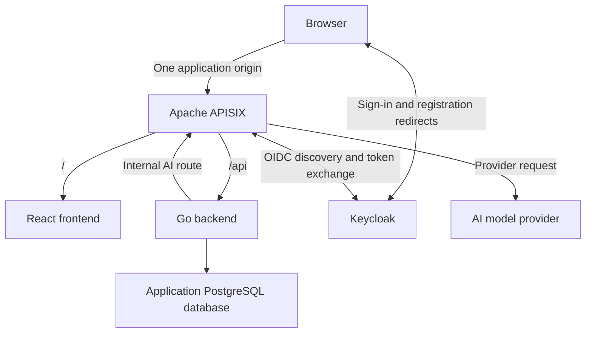

# Cartside

A conversational grocery storefront built with Go, React, PostgreSQL, and Apache APISIX.

Cartside lets customers browse groceries, search for products, and build a cart manually or with help from an AI shopping assistant. The assistant suggests products from the catalog, and customers accept or decline each suggestion before anything is added to their cart.

This is a personal learning project focused on Go application design, API gateway policies, OIDC integration, and AI provider integration.

## Project status

Implemented: the Go/Chi server, public liveness and PostgreSQL readiness, shared pgx v5 pool, graceful shutdown, local PostgreSQL/APISIX/Keycloak infrastructure, and APISIX-managed OIDC registration/sign-in and logout. React checks backend readiness and offers logout; it stores no tokens. APISIX protects the frontend and non-health APIs with a browser session and provides a gateway-only session check. Go verifies access tokens and exposes the current subject/issuer through `/api/me`; React displays that identity. CI checks Go, frontend, and configuration independently. Business modules, resource authorization, and AI integration remain planned. Unless stated otherwise, the architecture below describes the intended design.

## MVP

- Open registration and sign-in, required to access the storefront and chat.
- A fixed sample grocery catalog with product images, prices, and search.
- A separate cart for each customer, with manual quantity changes and item removal.
- Immediate cart updates within the current browser.
- An embedded AI chat that recommends catalog products based on customer requests.
- Individual acceptance or rejection of each suggested item.
- Simulated checkout that saves an order, returns a confirmation number, and clears the cart.

Real payments, delivery integrations, live inventory, and synchronization across tabs or devices are outside the initial scope.

## Architecture



The incoming application routes and internal AI route have separate policies, initially within one APISIX instance. Keycloak uses its own database or isolated database configuration; application modules do not access its credential storage.

### Responsibilities

| Component | Responsibility |
| --- | --- |
| React | Storefront, search, cart, chat, suggestion acceptance, and checkout UI |
| APISIX | Application routing, OIDC login flow and session enforcement, AI routing, and request limits |
| Keycloak | Registration, credentials, and user authentication |
| Go | Application authorization, business rules, catalog access, carts, orders, and AI conversation coordination |
| PostgreSQL | Persistent application data |
| AI provider | Generate shopping suggestions using catalog context supplied by Go |

### Authentication and access

APISIX manages the OIDC flow with Keycloak and maintains the browser session. React does not manage OIDC tokens. Go independently verifies the access token forwarded by APISIX and serves the current identity. Per-customer resource authorization remains planned.

Go rejects forged identity headers and verifies signatures and claims independently. A valid access token can authenticate directly to Go; network isolation remains planned. Session configuration and state-changing requests must account for cookie security and CSRF protection. Registration, authentication callbacks, and operational health routes require deliberate routing exceptions.

The AI provider key belongs to APISIX. The internal AI route must require service authentication or internal access restrictions; a storefront session alone does not grant access to it. Per-user AI limits must use a verified identity propagated through the backend.

## Go backend

The backend will be a modular monolith: one Go application with five internal business modules. Currently, `internal/auth` verifies access tokens and provides a minimal principal, `cmd/api` manages process startup and shutdown, `internal/database` validates database configuration and creates the pool, and `internal/httpapi` serves public health and protected current-user routes. Pool creation does not wait for PostgreSQL. The process closes the shared pool after HTTP shutdown.

| Module | Responsibility |
| --- | --- |
| Accounts | Application user records and association with the identity provider |
| Catalog | Product data, search, and authoritative product prices |
| Cart | Cart ownership, items, quantities, and cart versions |
| Orders | Checkout coordination, order records, and confirmations |
| Shopping assistant | Conversation coordination, catalog context, and product suggestions |

Modules interact through defined operations rather than directly modifying another module's tables. Manual additions and accepted AI suggestions use the same cart operations. The model does not control authoritative product IDs, prices, or ownership decisions.

### Checkout consistency

The orders module coordinates checkout with cart and catalog operations.

- Save the order and clear the cart in one database transaction.
- Preserve the cart if the transaction fails.
- Associate each checkout attempt with an idempotency key scoped to the user.
- Return the existing confirmation when a completed attempt is retried.
- Associate checkout with the cart version the customer reviewed; reject stale attempts.
- Serialize checkout and cart mutations through a consistent cart-locking strategy.

Retrying the same checkout uses the same key. A changed cart requires a new checkout attempt. Database constraints and transaction boundaries enforce these rules alongside application validation.

## Repository organization

One repository contains the frontend, backend, infrastructure configuration, and documentation. The current layout is:

| Path | Contents |
| --- | --- |
| `frontend/` | React and TypeScript application |
| `backend/` | Go application and internal modules |
| `infra/` | APISIX and Keycloak configuration and supporting infrastructure |
| `.github/workflows/` | CI checks |
| `scripts/` | CI configuration parser and its pinned dependency |
| `compose.yaml` | Local infrastructure services |
| `.env.example` | Required local configuration with safe placeholders |

## Local development

React and Go are intended to run directly on the developer's machine. Docker Compose runs PostgreSQL, APISIX, and Keycloak. React runs on the host with Vite.

Open **http://localhost:9080**. APISIX routes `/api/*` to Go with `/api` removed, and all other paths to the host-run Vite server. The frontend calls relative `/api/health/ready` URLs; no separate browser API origin or CORS configuration is needed. The screen distinguishes loading, ready, unavailable (HTTP failure), and network-error states, with Retry to check again. Application access requires Keycloak sign-in. Shopping features remain planned; see the gateway authentication section below.

### Configuration

- Keep local configuration in an untracked `.env` file.
- Commit `.env.example` with required names, descriptions, and placeholders.
- Validate required configuration at service startup.
- Keep credentials, API keys, and session secrets out of Git and browser bundles.
- Choose deployment secret storage when the hosting environment is selected.

### Setup instructions

Use **Node.js 24 LTS** (24.x, including npm) for the frontend and Go 1.24.0 (matching `backend/go.mod`) for the backend; Docker Compose runs PostgreSQL 17.10. From the repository root:

```sh
cp .env.example .env
# Generate local secrets (Python 3); nothing secret is printed.
python3 - <<'PYCODE'
from pathlib import Path
import secrets
p = Path('.env')
lines = p.read_text().splitlines()
for key in ('POSTGRES_PASSWORD', 'KEYCLOAK_DB_PASSWORD', 'KEYCLOAK_ADMIN_PASSWORD', 'CARTSIDE_OIDC_CLIENT_SECRET', 'CARTSIDE_SESSION_SECRET'):
    matches = [i for i, line in enumerate(lines) if line.startswith(key + '=')]
    if not matches:
        lines.append(key + '=' + secrets.token_hex(32))
    elif lines[matches[0]].split('=', 1)[1].startswith('replace_with_'):
        lines[matches[0]] = key + '=' + secrets.token_hex(32)
if not any(line.startswith('KEYCLOAK_ADMIN_USERNAME=') for line in lines):
    lines.append('KEYCLOAK_ADMIN_USERNAME=local-admin')
# Synchronize only the example URL; preserve customized existing configuration.
values = dict(line.split('=', 1) for line in lines if '=' in line and not line.startswith('#'))
lines = [line.replace('replace_with_local_password', values['POSTGRES_PASSWORD'])
         if line.startswith('DATABASE_URL=') else line for line in lines]
p.write_text('\n'.join(lines) + '\n')
p.chmod(0o600)
PYCODE
docker compose config --quiet
docker compose up -d --wait
# Explicitly export the trusted local file into this shell before running Go:
set -a
. ./.env
set +a
cd backend
# Override older .env files that still use 127.0.0.1:8080.
HTTP_ADDR=0.0.0.0:8080 go run ./cmd/api
```

Compose automatically reads the root `.env` for interpolation of PostgreSQL settings; it does not export variables into your shell. Go reads only its process environment and does not load `.env`. The shell commands above export `DATABASE_URL`, the required `OIDC_*` verification settings, and the optional `HTTP_ADDR`. Only source a trusted file, using shell-compatible assignments. Alternatively, supply `DATABASE_URL` directly in the Go process environment.

`DATABASE_URL` is required and must be a PostgreSQL URL with a host, user, and database name. Missing or malformed configuration fails startup with a generic error. A database connection failure does not prevent startup. `HTTP_ADDR` defaults to `:8080`; the example binds all IPv4 interfaces so APISIX can reach Go. Local `sslmode=disable` is for this host-only development setup.

In a second terminal, from the repository root (do not source the root `.env` for Vite):

```sh
cd frontend
npm ci
npm run dev
```

Vite binds `0.0.0.0:5173` so the APISIX container can reach it. `strictPort` makes startup fail if 5173 is occupied. Open http://localhost:9080, including for HMR; do not use 5173 as the browser origin. Vite explicitly allows `localhost` and `host.docker.internal` (its built-in localhost/IP allowances also apply). The development WebSocket connects to `ws://localhost:9080` and APISIX forwards upgrades to Vite. The frontend route has a one-hour read inactivity timeout for development WebSockets; the API retains its existing timeouts and rewriting. Keep this development server on a trusted machine with inbound firewall restrictions, like Go.

Frontend configuration is committed in `frontend/vite.config.ts`; it needs no environment variables. Compose consumes root `POSTGRES_USER`, `POSTGRES_PASSWORD`, `POSTGRES_DB`, and the Keycloak/gateway variables documented below; host-run Go consumes `DATABASE_URL`, `HTTP_ADDR`, `OIDC_ISSUER`, `OIDC_AUDIENCE`, and `OIDC_JWKS_URL`. Compose does not run or configure Vite, and bind-mounted APISIX YAML is not interpolated. Never copy database credentials or other secrets into frontend `.env` files or `VITE_*` variables: those values can enter browser bundles. Changing the Vite port also requires changing the APISIX frontend upstream; changing the gateway address requires updating the WebSocket client address.

For a production bundle:

```sh
cd frontend
npm ci
npm run lint
npm run typecheck
npm run build
```

The build writes static files to `frontend/dist/`. Serving that bundle in production is outside this milestone; the current gateway upstream requires the Vite development server.

In another terminal, from the repository root:

```sh
curl -i http://127.0.0.1:9080/api/health/live
curl -i 'http://127.0.0.1:9080/api/health/ready?probe=gateway'
docker compose ps
# This checks APISIX itself, without calling Go or PostgreSQL:
docker compose exec -T apisix resty -I /usr/local/apisix/deps/share/lua/5.1 /usr/local/apisix/healthcheck.lua
```

With PostgreSQL available, both health routes return HTTP 200 and `{"status":"ok"}`. APISIX strips `/api` from the path, preserves query strings, and passes upstream status codes and bodies through. The frontend catch-all requires sign-in. Bare `/api` and `/api/*` require a session and return 401 without one. After login, `/api/nonexistent` reaches Go and returns its 404 body.

### Local Keycloak identity provider

Keycloak is pinned to `quay.io/keycloak/keycloak:26.8.1`, the supported community release selected for this milestone. It runs **development mode only**, with HTTP and insecure development defaults. This is not a production configuration. APISIX now handles application authentication. No identity headers are trusted by Go, and React handles no tokens.

The setup block above generates independent application, Keycloak, and gateway secrets in the ignored `.env` and restricts it to mode 0600. It replaces missing values or example placeholders while preserving existing credentials. Python 3 is required. For an existing checkout, run only its Python block without copying `.env.example` over your configuration.

Keep the existing application credentials when upgrading an initialized checkout. `.env.example` is a template, not a source of working passwords. Compose passes Keycloak secrets as container environment variables; Keycloak itself resolves `${CARTSIDE_OIDC_CLIENT_SECRET}` in the mounted realm JSON using its supported import substitution. Compose does **not** interpolate mounted JSON or scripts. Do not run plain `docker compose config`, echo secrets, or publish container inspection output. Local Docker administrators can inspect container environments.

The one-shot `keycloak-db` job runs after PostgreSQL is healthy and before Keycloak starts. It creates the fixed `keycloak` login role (without superuser, database-creation, or role-creation privileges), creates the separate `keycloak` database owned by that role, and reconciles its password from `KEYCLOAK_DB_PASSWORD`. Neither application database nor application role may be named `keycloak`. The job can be rerun safely on an initialized `postgres_data` volume:

```sh
docker compose run --rm keycloak-db
```

Provisioning uses the official PostgreSQL image's local Unix-socket trust authentication and the existing `POSTGRES_USER` administrator. A separate `postgres_socket` volume shares that socket only with the provisioning job; Keycloak uses password authentication over TCP. The existing setup already uses `POSTGRES_USER` as the local application role and PostgreSQL bootstrap superuser. This milestone does not change that role or its password. Customized existing PostgreSQL installations that disable local trust or remove this administrator need equivalent administrator access for provisioning. Do not delete `postgres_data`; initialization scripts and `POSTGRES_*` changes do not update initialized databases. Adding the socket mount recreates the PostgreSQL container once, preserving its data volume.

`start-dev --import-realm` imports `infra/keycloak/cartside-realm.json` only if `cartside` does not exist. The realm allows registration. The confidential `cartside-apisix` client enables Authorization Code flow and client-secret authentication; implicit flow, direct password grants, and service accounts are disabled. Its only login redirect is **`http://localhost:9080/auth/callback`**, and its only post-logout redirect is **`http://localhost:9080/signed-out`**. There are no wildcard redirects or allowed browser web origins. APISIX handles both the callback and logout; neither reaches React or Go. Keycloak's built-in account-console client separately supports the account UI.

| Purpose | URL |
| --- | --- |
| Canonical issuer | `http://localhost:8180/realms/cartside` |
| Account console (registration and sign-in) | http://localhost:8180/realms/cartside/account/ |
| Local admin console | http://localhost:8180/admin/ |
| Browser discovery | http://localhost:8180/realms/cartside/.well-known/openid-configuration |
| APISIX discovery | `http://keycloak:8080/realms/cartside/.well-known/openid-configuration` |

Use `localhost` consistently in the browser, including for the application on port 9080. Keycloak publishes only `127.0.0.1:8180`; its management port 9000 is not published. `KC_HOSTNAME` fixes the public issuer and authorization URLs. `KC_HOSTNAME_BACKCHANNEL_DYNAMIC=true` lets discovery requested through Compose DNS advertise `http://keycloak:8080` token and JWKS endpoints while preserving the public issuer and browser authorization URL. APISIX requests discovery through `keycloak:8080`, then uses those internal token/key endpoints. Container `localhost` is the APISIX container itself, so it must not call `localhost:8180`. The internal discovery issuer remains the canonical public issuer; do not replace it with the internal address. The public issuer remains validated during Code flow; internal transport URLs do not change the issuer.

Health and metrics are enabled at startup (the stock image applies build options automatically). Metrics enable the database readiness check. The probe uses the supported `/health/ready` management endpoint on port 9000 and Bash TCP sockets because the selected image has Bash but no curl/wget. It checks HTTP 200, has a three-second Compose timeout, and was executed successfully in the pinned image. Readiness is informational; it does not automatically restart Keycloak.

### Keycloak changes, restarts, and verification

Realm and user data live in PostgreSQL, including client secrets and passwords. Restarting or recreating Keycloak preserves them. **Startup import skips an existing realm**, so editing JSON or changing the client secret in `.env` does not update that realm. For later configuration changes, edit the committed template for fresh installations and apply the matching changes to the existing realm through the supported Admin Console (realm settings → Login; Clients → `cartside-apisix` → Settings / Credentials). Preserve registered users; do not delete or overwrite the realm to apply settings. Set an existing client's secret explicitly in Credentials if changing `CARTSIDE_OIDC_CLIENT_SECRET`, then use the same value in future APISIX configuration. Admin bootstrap variables apply only when creating the initial administrator; change an existing administrator password through the console. The bootstrap administrator is temporary; create a permanent local administrator and remove the bootstrap account if keeping this environment long term.

For database password rotation, edit `.env`, rerun the provisioning job, and recreate Keycloak. This briefly interrupts its database access. Startup/environment changes require recreation; a plain restart retains the old container environment:

```sh
docker compose run --rm keycloak-db
docker compose up -d --force-recreate --wait keycloak
```

For ordinary persistence verification, run the Compose commands from the repository root. Compose starts infrastructure only. Before checking the four Go health URLs, keep the host-run Go server running in a separate terminal:

```sh
cd /path/to/cartside
set -a
. ./.env
set +a
cd backend
HTTP_ADDR=0.0.0.0:8080 go run ./cmd/api
```

Keep that terminal open; run the verification commands below in another terminal. For frontend browser checks, also keep Vite running using the frontend setup commands above. A refused connection on port 8080 together with gateway HTTP 502 means the Go upstream is not reachable; Keycloak health does not imply that Go is running.

```sh
docker compose config --quiet
docker compose ps -a
docker compose exec -T keycloak bash /opt/keycloak/healthcheck.sh
curl -fsS http://localhost:8180/realms/cartside/.well-known/openid-configuration
curl -fsS http://localhost:8180/realms/cartside/protocol/openid-connect/certs
# Register through the account console before restarting.
docker compose restart keycloak
docker compose up -d --wait keycloak
docker compose exec -T keycloak bash /opt/keycloak/healthcheck.sh
curl -fsS http://localhost:9080/api/health/live
curl -fsS http://localhost:9080/api/health/ready
curl -fsS http://localhost:8080/health/live
curl -fsS http://localhost:8080/health/ready
```

In the browser, open the account console, select Register on its sign-in page, complete the form, and confirm Personal info shows your account. After restarting Keycloak, use a fresh private window, sign in with the same credentials, and confirm the same account. Open http://localhost:9080 and a frontend fallback path such as http://localhost:9080/catalog; both should show Backend ready. Registration here creates only a Keycloak user; it creates no application account.

Container-network discovery and key verification (uses the existing APISIX image's HTTP client; prints only public URLs):

```sh
docker compose exec -T apisix resty -I /usr/local/apisix/deps/share/lua/5.1 -e '
local h = require("resty.http").new()
h:set_timeout(2000)
local r = assert(h:request_uri("http://keycloak:8080/realms/cartside/.well-known/openid-configuration"))
assert(r.status == 200)
local d = require("cjson").decode(r.body)
assert(d.issuer == "http://localhost:8180/realms/cartside")
print(d.issuer); print(d.authorization_endpoint); print(d.token_endpoint); print(d.jwks_uri)
assert(assert(h:request_uri(d.jwks_uri)).status == 200)
local t = assert(h:request_uri(d.token_endpoint, {
  method="POST", body="grant_type=client_credentials&client_id=cartside-apisix",
  headers={["Content-Type"]="application/x-www-form-urlencoded"}
}))
assert(t.status == 401) -- endpoint reachable; missing client credentials rejected
'
```

Official references pinned to the selected [Keycloak 26.8.1 container guide](https://github.com/keycloak/keycloak/blob/26.8.1/docs/guides/server/containers.adoc), [health guide](https://github.com/keycloak/keycloak/blob/26.8.1/docs/guides/observability/health.adoc), [hostname guide](https://github.com/keycloak/keycloak/blob/26.8.1/docs/guides/server/hostname.adoc), [realm import guide](https://github.com/keycloak/keycloak/blob/26.8.1/docs/guides/server/importExport.adoc), and [APISIX 3.14 OIDC plugin](https://apisix.apache.org/docs/apisix/3.14/plugins/openid-connect/).

### Container-to-host networking and exposure

APISIX connects to `host.docker.internal:8080`. Compose adds Docker's `host-gateway` mapping for Linux Docker Engine (20.10+). On native Linux this normally resolves to a Docker bridge address on the host. Go must listen on an interface reachable at that address: a loopback-only listener is insufficient. `HTTP_ADDR=0.0.0.0:8080` works across interfaces, or on native Linux you can bind only the relevant Docker bridge address if it is stable and reachable. Host firewall rules must allow traffic from the Docker network.

Docker Desktop normally supplies `host.docker.internal` through its host networking integration; the explicit host-gateway mapping must resolve to a reachable host address in your Desktop installation. Confirm with `docker compose exec apisix cat /etc/hosts` and the gateway requests above. Desktop runs containers inside a VM, so do not assume that a native Linux bridge address exists on the desktop host. If using a remote Docker context, this name refers to the Docker host, not necessarily the machine running Go. Use a local Docker context for this setup.

The gateway port is published only on `127.0.0.1:9080`. Binding Go to `0.0.0.0:8080` also exposes its direct listener on LAN interfaces, subject to the host firewall; use a trusted development machine and restrict inbound access. Gateway routes authenticate browser sessions, but this development topology does **not** prevent direct access to host Go or Vite, or enforce gateway-exclusive access. Go verifies access tokens independently and never trusts plain identity headers. Ports 5432, 8180, 9080, 8080, and 5173 must be available. Do not stop another checkout’s services without permission. A separate Compose project isolates volumes but does not isolate published ports; changing ports also requires coordinated gateway, Vite WebSocket, issuer, and realm redirect changes.

### Gateway configuration and health

`infra/apisix/config.yaml` selects file-driven standalone mode (`deployment.role: data_plane`, `role_data_plane.config_provider: yaml`) and disables the Admin API and TLS listener. `infra/apisix/apisix.yaml` defines public health/landing routes, protected APIs/session check, and a protected frontend catch-all and must retain its final `#END` marker. Both files and the health probe are mounted read-only. There is no etcd, dashboard, or Admin API. The enabled OIDC plugin handles authentication; serverless functions sanitize unused incoming identity headers and serve minimal gateway responses.

The pinned image is `apache/apisix:3.14.1-debian`. Configuration follows the official APISIX 3.14 [deployment modes](https://apisix.apache.org/docs/apisix/3.14/deployment-modes/), [proxy-rewrite](https://apisix.apache.org/docs/apisix/3.14/plugins/proxy-rewrite/), [upstream timeout schema](https://apisix.apache.org/docs/apisix/3.14/admin-api/#upstream), and the [3.14.1 Control API documentation](https://github.com/apache/apisix/blob/3.14.1/docs/en/latest/control-api.md). Connection timeout is 1 second; send and read inactivity timeouts are 5 seconds each. Retries are disabled. These bound stalled upstream operations, rather than setting a total streaming-response deadline.

The image includes `resty` and its HTTP client library (verified); it does not include `curl` or `wget`. The Compose health check uses `resty` with a two-second HTTP timeout to request `/v1/healthcheck` on the container-only control listener, `127.0.0.1:9090`. The probe checks that the control endpoint returns 200; it does not interpret upstream health or call Go. Neither control port 9090 nor Admin port 9180 is published. APISIX can remain healthy when Go is stopped or PostgreSQL is unavailable. Application readiness is checked separately through `/api/health/ready`.

The frontend route enables WebSocket upgrades; see the [Vite server options](https://vite.dev/config/server-options) and [APISIX route schema](https://apisix.apache.org/docs/apisix/3.14/admin-api/#route). APISIX receives only the OIDC client secret and separate session secret through its environment, not database credentials or the `.env` file. Its committed YAML uses fixed local ports and an upstream address; Compose does not interpolate bind-mounted file contents. Changing `HTTP_ADDR` changes Go only: if changing its port, also update the upstream in `infra/apisix/apisix.yaml`. After configuration changes, use `docker compose up -d --force-recreate --wait apisix` so both startup settings and newly replaced bind-mounted files are loaded.

### Outage and configuration verification

```sh
docker compose config --quiet
docker compose exec -T apisix apisix test
docker compose exec -T apisix sh -c 'command -v resty'
docker compose stop postgres
curl -i http://127.0.0.1:9080/api/health/live
curl -i http://127.0.0.1:9080/api/health/ready
docker compose ps apisix
docker compose up -d --wait postgres
curl -i http://127.0.0.1:9080/api/health/ready
```

While PostgreSQL is stopped, liveness stays 200 and readiness returns HTTP 503 with `{"status":"unavailable"}` through APISIX. Each readiness request pings through the shared pool with a one-second context timeout; subsequent requests recover after PostgreSQL returns, without restarting Go or APISIX.

Stop Go with Ctrl+C: `/api/health/live` then returns a gateway error (normally 502 for connection refusal, 504 for an upstream timeout), while APISIX stays healthy. Restart Go using the setup command and verify both gateway health routes return 200 again. SIGINT or SIGTERM gives Go up to 10 seconds for active HTTP requests, followed by pool closure.

PostgreSQL data persists in the Compose named volume across stops and container recreation. Use `docker compose stop` to stop infrastructure without deleting data. Do not use `docker compose down -v` unless intentionally deleting data. PostgreSQL initialization variables apply only to an empty volume; changing credentials in `.env` does not change an existing database user's password.

Backend validation commands (run from `backend/`):

```sh
gofmt -w cmd internal
go vet ./...
go test ./...
go build ./...
```

Browser verification (with all three processes running):

- Open http://localhost:9080 and confirm “Backend ready”; inspect assets and the HMR WebSocket in browser developer tools: all must use port 9080.
- Edit visible text in `frontend/src/App.tsx`; confirm it changes without a document reload and without a direct connection to port 5173, then restore the edit.
- Stop PostgreSQL using `docker compose stop postgres`, click Retry, and confirm “Backend unavailable”. Liveness and the independent APISIX health check must still pass.
- Restore PostgreSQL with `docker compose up -d --wait postgres`, click Retry, and confirm “Backend ready”. No volume deletion or Go restart is required.
- In browser developer tools, delay the readiness request to observe loading, or block `/api/health/ready` and click Retry to observe “Network error”. Unblock and retry to recover.

The gateway authentication procedure and remaining security boundaries are documented below.

## Health checks

- **Go liveness (implemented):** `GET /health/live` confirms the process can respond.
- **Go readiness (implemented):** `GET /health/ready` checks PostgreSQL reachability with a bounded ping.
- **Infrastructure health:** APISIX control, PostgreSQL, and Keycloak readiness checks are implemented.
- **Routing check (implemented):** `/api/health/live` and `/api/health/ready` reach Go through APISIX.
- **Authentication check (implemented):** `/auth/session` verifies the gateway session without calling Go; unauthenticated non-health APIs return 401. Go verifies identity separately at `/api/me`.

Routine health probes do not call a paid AI provider. Healthy individual services do not replace checks of routing and authentication across components.

## CI and delivery

`.github/workflows/ci.yml` runs on pull requests, pushes to `main`, and manual dispatch. Independent **Backend**, **Frontend**, and **Configuration** jobs use read-only repository permissions and cancel superseded runs for the same PR or branch. Official actions are pinned to full commit SHAs with release comments; update both together.

- Backend: non-mutating formatting check, vet, race tests, and build. Go comes from `backend/go.mod`; dependencies are cached against `backend/go.sum`. Tests use local fixtures and need no PostgreSQL, Keycloak, credentials, or repository secrets.
- Frontend: Node comes from `frontend/package.json`; npm caches against `frontend/package-lock.json`. Runs `npm ci`, lint, typecheck, and production build. There is no frontend test suite yet.
- Configuration: Python 3.13 and pinned PyYAML parse tracked JSON/YAML; Compose validates with disposable values for every required variable and `config --quiet`. No rendered credentials are printed. Parsing does not prove runtime APISIX schemas, routing, or OIDC behavior; CI does not start the identity stack.

GitHub-hosted Ubuntu runners provide Docker Compose and the C compiler needed for race tests. Local checks require the Go/Node versions above, Python 3 (install `scripts/requirements-ci.txt` in a virtual environment for configuration parsing), and Docker Engine/Desktop with Compose v2 and a local context. GitHub Actions must be enabled in repository settings; no repository secrets are needed. Confirm all three jobs after pushing; a local pass is not a remote CI pass. Deployment and artifact publishing remain future work.

## Phase 1: foundation

Implementation order:

1. Create the repository scaffold and configuration template.
2. Establish local infrastructure with Docker Compose.
3. Add Go liveness and PostgreSQL readiness checks.
4. Route the frontend and backend through APISIX.
5. Configure Keycloak registration and APISIX-managed sign-in.
6. Add a protected current-user endpoint and verify authentication boundaries.
7. Add CI and verify the documented setup from a fresh clone.

Exit criteria:

- [x] Go runs locally with a configurable listen address and graceful shutdown.
- [x] Go liveness responds directly with HTTP 200 and the expected JSON, without authentication or external dependency checks.
- [x] Backend formatting, vet, test, and build checks pass.
- [x] The README contains verified backend run and liveness verification commands.
- [x] Local PostgreSQL and Go configuration is documented in the committed template.
- [x] Local PostgreSQL, APISIX, and Keycloak infrastructure is configured with Docker Compose.
- [x] React and Go run locally behind APISIX.
- [x] Go liveness and readiness checks work through the gateway.
- [x] A customer can register and sign in through Keycloak’s account console and the APISIX-managed application flow.
- [x] An authenticated request reaches a protected Go endpoint and resolves the user's identity.
- [x] An unauthenticated non-health API request is rejected.
- [x] Initial CI checks pass.
- [ ] Full setup works from a fresh checkout with new secrets and isolated volumes, including registration, sign-in, `/api/me`, logout, and persistence after restart.

### Fresh-checkout verification (2026-10-15)

A separate local clone with the pending CI/documentation changes overlaid used newly generated secrets and Compose project `cartside-phase1-ue8j6g0u`, with its own data/socket volumes. Automated checks passed: Go formatting, vet, unit/race tests and build; Node 24 `npm ci`, lint, typecheck and build; actionlint; tracked JSON/YAML parsing with PyYAML 6.0.3, including rejection of malformed fixtures; and quiet Compose validation with both new secrets and disposable CI values.

All five documented ports were occupied by the developer’s running services. Those services, configuration, users, and volumes were untouched. Supplemental runtime checks used a temporary override: PostgreSQL published an ephemeral loopback port; APISIX and Keycloak published no ports. Go and Vite used free loopback ports. Infrastructure became healthy; APISIX’s configuration test and independent health probe passed; direct Go liveness/readiness returned 200, unauthenticated `/me` returned 401, and Vite served HTTP 200. The imported realm retained its database ID across PostgreSQL/Keycloak restart. This verifies realm persistence, not customer sign-in persistence. Only temporary processes, containers, network, volumes, secrets, and checkout were removed.

**No browser checks were performed in this fresh checkout.** The prior README recorded Chrome registration/sign-in, identity display and `/api/me`, header-forgery rejection, HMR, and logout against initialized volumes. Those earlier checks underpin the checked authentication criteria above; they do not establish fresh-install success. Exact README runtime setup, gateway-to-host routing, registration, authenticated `/api/me`, logout, and customer persistence remain unverified in isolation because of fixed-address conflicts. GitHub Actions Backend, Frontend, and Configuration jobs passed on commit `bc931a2` in the [manually dispatched run](https://github.com/WilliamSchweitzer/cartside/actions/runs/38826000326). The host lacked `python3-venv`/pip, so the local parser check used the pinned PyYAML wheel extracted into the temporary directory; CI installs it normally with setup-python/pip.

Remaining manual checklist, on a machine where the documented ports are free:

- [ ] Clone separately; select a unique Compose project (`export COMPOSE_PROJECT_NAME=cartside-fresh-check`), copy the template, and follow Setup instructions with new secrets. Never reuse another checkout’s `.env` or volumes.
- [ ] Confirm all infrastructure is healthy; start Go and Vite exactly as documented. Verify direct and gateway health routes, APISIX’s independent probe, and signed-out API/session 401 responses.
- [ ] In a private browser, register and sign in through the gateway. Confirm Backend ready, protected assets/HMR through 9080, `/auth/session`, and minimal no-store `/api/me` matching the displayed identity.
- [ ] Restart this project’s PostgreSQL and Keycloak, then sign in in a fresh private window with the same customer; confirm the same subject and working readiness.
- [ ] Sign out, confirm the stable landing page and API/session 401 responses, then confirm a new login requires credentials.
- [ ] Stop only this checkout’s host processes. From this disposable checkout, remove only its resources with `docker compose -p cartside-fresh-check down -v`, then remove its temporary secrets/checkout.

## Later milestones

- Implement the product catalog and search.
- Implement customer carts and ownership checks.
- Add AI suggestions and explicit customer acceptance.
- Implement simulated checkout and retry protections.
- Prepare deployment and managed secret delivery.

Building a custom Go OIDC provider is a potential separate learning milestone after the application works with Keycloak.

## Gateway authentication (implemented)

Use **http://localhost:9080** consistently. APISIX 3.14.1 uses the existing confidential `cartside-apisix` client with Authorization Code, PKCE, state, and nonce. It owns encrypted, signed HttpOnly browser cookies and all tokens; React has no OIDC library or token storage. Never open Vite directly to test authentication.

For an existing checkout, run the secret-generation block above: it now adds `CARTSIDE_SESSION_SECRET` without replacing existing credentials. Generate each secret independently with Python `secrets.token_hex(32)` (32 random bytes, encoded as hex). Do not rotate the existing client secret just to add the session secret. Compose requires both secrets and passes them only to APISIX; `nginx_config.envs` explicitly preserves them in Nginx workers. Plugin fields use supported `$ENV://CARTSIDE_OIDC_CLIENT_SECRET` and `$ENV://CARTSIDE_SESSION_SECRET` references. Mounted YAML is not Compose interpolation. Changing a session secret invalidates existing gateway cookies.

**For the gateway-session setup, existing realms require the logout setting below:** startup import skips them. The backend identity milestone also requires the audience reconciliation described below. In the local Keycloak Admin Console, select realm `cartside`, Clients → `cartside-apisix` → Settings → Logout settings. Set Valid post logout redirect URIs to exactly `http://localhost:9080/signed-out` and save. Keep the login redirect exactly `http://localhost:9080/auth/callback`, the existing client secret, and all users. The committed realm template already has these settings for new installations. Do not delete/import over an initialized realm or delete database volumes. Then run:

```sh
docker compose config --quiet
docker compose up -d --force-recreate --wait apisix
docker compose exec -T apisix apisix test
```

| Request | Gateway behavior |
| --- | --- |
| `/`, frontend paths, assets, HMR | Session required; signed-out navigation redirects to Keycloak |
| `/auth/callback` | OIDC plugin checks state/nonce, exchanges the code internally, validates the ID token and issuer, saves the session, then redirects to the original app path |
| `/auth/session` | Session required; returns only `{"authenticated":true}` with no-store, or 401; no upstream |
| `/api/health/live`, `/api/health/ready` | Exact public exceptions, forwarded to Go with `/api` stripped |
| `/api`, other `/api/*` | Cookie session required; 401 without a session, otherwise forwarded with `/api` stripped and query preserved |
| `/auth/logout` | Clears the gateway cookie and redirects to Keycloak's discovered end-session endpoint with ID-token hint and a fixed approved post-logout URL |
| `/signed-out` | Public gateway HTML, no-store, with an explicit sign-in link; no Vite dependency or automatic login |

Protected routes share identical session secret, cookie path `/`, cookie flags and lifetime. API routes use `bearer_only: false` with `unauth_action: deny`, so the browser cookie works without redirecting fetches to HTML. Incoming Authorization and common token/identity headers are cleared before authentication; identity output headers are disabled; only backend routes forward the authenticated session access token as X-Access-Token. Cookies are removed before upstream forwarding, after authentication. Go verifies that token independently and exposes minimal verified identity at `/api/me`. Only exact health paths bypass authentication; unknown API paths return Go's 404 after login.

Keycloak discovery is fetched at `http://keycloak:8080/realms/cartside/.well-known/openid-configuration`. Hostname v2 keeps issuer and browser authorization/logout URLs at `http://localhost:8180`, while dynamic backchannel discovery advertises internal token and key URLs. Issuer validation remains enabled. No container needs to reach the host's `localhost:8180`.

### Session and development security limits

Cookies use HttpOnly, SameSite=Lax (compatible with top-level Code callbacks), no Domain, and a 3600-second lifetime. The pinned lua-resty-session 3.10 uses renewable cookie expiration: this is a bounded rolling session, not a fixed absolute login deadline. Keycloak session/token expiration also applies. Local HTTP requires `secure: false`; deployment requires HTTPS, `secure: true`, approved HTTPS issuer/callback/logout URLs, TLS verification, restricted upstream network access, and a deliberate absolute/idle session policy. This milestone supplies no production deployment or access isolation.

APISIX access logging is disabled because default request logs include callback query strings. Error logging is restricted to `crit` to avoid OIDC error messages containing sensitive provider responses. Do not enable debug/verbose HTTP tracing, capture cookies, or publish HAR files containing codes/tokens. Local Docker administrators can inspect environment secrets. The encrypted cookie contains tokens managed by APISIX; HttpOnly prevents frontend JavaScript access. Cookie deletion and Keycloak logout end the browser sessions; stateless gateway cookies do not provide a server-side revocation list for a stolen cookie. Central revocation/session storage is a deployment consideration.

Logout always uses the fixed local post-logout URL; query parameters do not select a redirect destination. Keycloak validates its exact redirect allowlist. The public landing page does not automatically start login. Logout is a navigation GET supported by the pinned OIDC library; SameSite=Lax does not itself prevent forced logout.

**CSRF enforcement is a prerequisite for authenticated business mutations.** There are no such endpoints in this milestone. Before adding them, enforce an origin policy and CSRF tokens in addition to resource authorization, validate inputs in Go, and define the application account/ownership model. SameSite cookies alone are insufficient. State/nonce protect the login flow, not application mutations. Host ports 8080 and 5173 remain reachable directly, bypassing the gateway. Restrict host firewall access in development; establish network isolation before claiming gateway-exclusive access; Go already validates forwarded tokens independently.

### Authentication verification

Start Go and Vite as described above. Without cookies:

```sh
# 302 to Keycloak (do not publish Location headers from a live login):
curl -s -o /dev/null -w '%{http_code}\n' http://localhost:9080/
# Each must return 401, without following redirects:
curl -s -o /dev/null -w '%{http_code}\n' http://localhost:9080/auth/session
curl -s -o /dev/null -w '%{http_code}\n' http://localhost:9080/api/nonexistent
curl -s -o /dev/null -w '%{http_code}\n' http://localhost:9080/api
# 200 when Go/PostgreSQL are ready; landing is independent:
curl -fsS http://localhost:9080/api/health/live
curl -fsS http://localhost:9080/api/health/ready
curl -s -o /dev/null -w '%{http_code}\n' http://localhost:9080/signed-out
```

In a fresh private browser:

1. Visit the gateway; confirm a Keycloak login page. Register or sign in and confirm return to the app, protected assets, and “Backend ready”.
2. Fetch `/auth/session` from that tab with same-origin credentials: expect 200 and only `{"authenticated":true}`. Fetch `/api/nonexistent`: expect Go's 404, proving the cookie passes API enforcement. A fresh cookie-free browser must receive 401 for both.
3. Click Retry readiness check. Make a temporary visible text edit in `frontend/src/App.tsx`, confirm HMR without document reload and the WebSocket through port 9080, then restore it.
4. Click Sign out; confirm Keycloak ends SSO and returns to `/signed-out`. Reload: it must stay there. `/auth/session` and non-health APIs must now return 401. Click Sign in: credentials must be required again.

Version-matched implementation references: [APISIX OIDC plugin 3.14.1](https://github.com/apache/apisix/blob/3.14.1/apisix/plugins/openid-connect.lua), [secret resolution](https://github.com/apache/apisix/blob/3.14.1/apisix/secret.lua), [environment references](https://github.com/apache/apisix/blob/3.14.1/apisix/core/env.lua), [Nginx environment template](https://github.com/apache/apisix/blob/3.14.1/apisix/cli/ngx_tpl.lua), [pinned dependencies](https://github.com/apache/apisix/blob/3.14.1/apisix-master-0.rockspec), [lua-resty-openidc 1.7.6](https://github.com/zmartzone/lua-resty-openidc/blob/v1.7.6/lib/resty/openidc.lua), [lua-resty-session 3.10](https://github.com/bungle/lua-resty-session/blob/v3.10/lib/resty/session.lua), [Keycloak hostname 26.8.1](https://github.com/keycloak/keycloak/blob/26.8.1/docs/guides/server/hostname.adoc), and [Keycloak logout validation 26.8.1](https://github.com/keycloak/keycloak/blob/26.8.1/services/src/main/java/org/keycloak/protocol/oidc/endpoints/LogoutEndpoint.java).

## Verified backend identity

Implemented in this milestone: Go independently validates the session access token and serves `GET /me` (`GET /api/me` through APISIX). The response is only `{"subject":"…","issuer":"…"}` with `Cache-Control: no-store`. Missing or invalid credentials produce generic JSON 401 responses. Every Go route except exact GET liveness/readiness paths passes through authentication, including unknown routes and unsupported methods. React uses a relative `/api/me` fetch and displays loading, identity, renewal-required/401, and service-failure states. Renewal is explicit navigation through logout and the signed-out sign-in link; fetches never trigger a redirect loop.

### Configuration and existing realms

Add these values to an existing ignored `.env` before starting the new Go binary (they are already in the template for new checkouts):

```sh
OIDC_ISSUER=http://localhost:8180/realms/cartside
OIDC_AUDIENCE=cartside-api
OIDC_JWKS_URL=http://localhost:8180/realms/cartside/protocol/openid-connect/certs
```

All three are required at Go startup. The issuer is the exact token identity, including scheme/host/path; the independently configured JWKS URL is a reachable transport endpoint. Host-run Go reaches Keycloak via localhost:8180; APISIX still uses Compose DNS. Neither issuer nor audience validation is disabled. Configuration validation performs no network calls. Liveness remains process-only and readiness remains PostgreSQL-only, including during a Keycloak outage.

Fresh imports define a bearer-only `cartside-api` client and an `oidc-audience-mapper` on `cartside-apisix`, with `included.client.audience=cartside-api`, access-token inclusion enabled and ID-token inclusion disabled. This explicit mapper adds the backend audience without requiring a browser-requested optional scope. The API client has no browser login, password grant, or service-account flow.

Startup import does not modify an existing realm. Apply the same configuration with the committed, idempotent Admin REST reconciliation script, using the existing local administrator credentials:

```sh
# From the repository root; source only your trusted local file.
set -a
. ./.env
set +a
python3 infra/keycloak/reconcile-audience.py
# Safe to repeat. Does not delete realms, users, or volumes, or rotate secrets.
docker compose config --quiet
docker compose up -d --force-recreate --wait apisix
docker compose exec -T apisix apisix test
# Restart the host Go process with the exported verification settings.
```

The script reads the committed realm template, creates/updates only the API client and named gateway audience mapper, and suppresses credentials, tokens, and provider error bodies. It requires Python 3 and a reachable local Keycloak administrator API. Existing access tokens retain their original claims until replaced. **Sign out and sign in again after applying the mapper** to obtain a token with the new audience; an old session can pass `/auth/session` while `/api/me` correctly rejects its old token.

### Trust boundary and verification policy

In APISIX's rewrite phase, `serverless-pre-function` (priority 10000) clears client Authorization, X-Access-Token, X-ID-Token, X-Refresh-Token, X-Userinfo, X-User-ID and X-Forwarded-User headers. `openid-connect` (2599) then authenticates the browser cookie and sets **`X-Access-Token`**, containing only the authenticated session's raw access token, on backend routes. `proxy-rewrite` (1008) removes Cookie and rewrites the path; it preserves this newly generated token. Session-check responses run in `serverless-post-function` (-2000). These priorities were checked in the pinned running image. Frontend and session-check routes keep token output disabled. Header names are case-insensitive. Go consumes only X-Access-Token; it ignores Authorization and all plain identity headers. No upstream echoes credentials, and gateway access logging remains disabled with error logging restricted to `crit`.

Go uses `github.com/coreos/go-oidc/v3` v3.14.1 with an explicit RS256 allowlist, signature verification, exact issuer and backend audience checks, required unexpired expiration and nonempty subject, and validation of `nbf` and `iat` when present. No positive clock-skew allowance is applied by the application; keep clocks synchronized. The reusable remote JWKS set caches keys and fetches again when the signing key changes. HTTP key retrieval has a three-second client timeout, redirects disabled, and verification has a four-second request deadline. A known cached key can verify during an outage; an unverifiable token fails closed. Verification errors and token values are never logged or returned. Only the verified subject and issuer enter the request context.

The durable external identity is **(issuer, subject)**, never email. There is no application user table or migration. Gateway authentication establishes a browser session; Go token validation establishes a cryptographically verified caller. Future resource authorization must separately decide which carts/orders that caller can access, and must accompany CSRF controls before adding mutations. This milestone adds no authenticated mutations.

Local HTTP, insecure development cookie settings, and reachable host ports remain limitations. **A valid access token can authenticate directly to Go using X-Access-Token.** Network isolation and gateway-exclusive access are not implemented. Direct Vite also remains reachable. Tokens, session cookies and administrator credentials need trusted HTTPS transport and appropriate network controls in deployment. Local JWT validation does not immediately revoke an already issued access token on browser logout; it remains usable until expiration unless a future revocation policy is added. React receives no raw tokens and never stores them; the browser carries APISIX's encrypted HttpOnly session cookie.

### Verification

Unit tests generate local RSA keys and serve local JWKS fixtures; they require no Keycloak. They cover absent/malformed/duplicate tokens, forged plain identity headers, invalid signature, a disallowed algorithm, wrong/missing issuer or audience, expired/missing expiration, missing/empty subject, future/malformed time claims, successful minimal identity, cached keys during outage, key rotation, unavailable keys, protected unknown routes/methods, public health, and invalid startup configuration.

```sh
cd backend
gofmt -w cmd internal
go vet ./...
go test ./...
go test -race ./...
go build ./...
cd ../frontend
# Use Node 24 (the project's pinned runtime).
npm run lint
npm run typecheck
npm run build
cd ..
docker compose config --quiet
docker compose exec -T apisix apisix test
# Signed out: all must return 401, without following redirects.
curl -s -o /dev/null -w '%{http_code}\n' http://localhost:9080/api/me
curl -s -o /dev/null -w '%{http_code}\n' http://localhost:9080/auth/session
curl -s -o /dev/null -w '%{http_code}\n' -H 'X-User-ID: forged' -H 'X-Forwarded-User: forged' http://localhost:8080/me
curl -s -o /dev/null -w '%{http_code}\n' -H 'X-Access-Token: fake' http://localhost:8080/me
```

In a signed-in browser, fetch `/api/me` with same-origin credentials and check the minimal subject/issuer JSON and no-store header. Repeat with fake Authorization, X-Access-Token and identity headers: the result must remain the authenticated session's identity. Do not print/copy cookies or real tokens. Check `/auth/session`, readiness Retry, logout, and the signed-out landing page as described above. To inspect the identity UI, delay `/api/me`, simulate a 503 then Retry, and simulate a 401; the latter must show explicit return-to-sign-in navigation without automatic redirects.

Version-matched official references: [APISIX 3.14.1 OIDC forwarding](https://github.com/apache/apisix/blob/3.14.1/apisix/plugins/openid-connect.lua), [pre-function priority](https://github.com/apache/apisix/blob/3.14.1/apisix/plugins/serverless-pre-function.lua), [proxy-rewrite priority and phase](https://github.com/apache/apisix/blob/3.14.1/apisix/plugins/proxy-rewrite.lua), [Keycloak 26.8.1 audience mapper](https://github.com/keycloak/keycloak/blob/26.8.1/services/src/main/java/org/keycloak/protocol/oidc/mappers/AudienceProtocolMapper.java), [Keycloak 26.8.1 Admin REST API](https://www.keycloak.org/docs-api/26.8.1/rest-api/index.html), [go-oidc v3.14.1 verifier](https://github.com/coreos/go-oidc/blob/v3.14.1/oidc/verify.go), and [cached JWKS and rotation](https://github.com/coreos/go-oidc/blob/v3.14.1/oidc/jwks.go).
