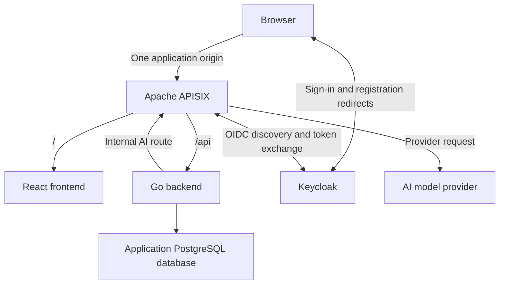

# Cartside

A conversational grocery storefront built with Go, React, PostgreSQL, and Apache APISIX.

Cartside lets customers browse groceries, search for products, and build a cart manually or with help from an AI shopping assistant. The assistant suggests products from the catalog, and customers accept or decline each suggestion before anything is added to their cart.

This is a personal learning project focused on Go application design, API gateway policies, OIDC integration, and AI provider integration.

## Project status

Implemented: the Go/Chi server, unauthenticated liveness and PostgreSQL readiness, a shared pgx v5 pool, graceful shutdown, and local PostgreSQL, Apache APISIX, and Keycloak in Docker Compose. Keycloak provides persistent realm registration and account-console sign-in; the future gateway client is provisioned but application authentication is not enabled. APISIX forwards `/api/*` to the host-running Go server with the prefix removed. A minimal React/TypeScript landing screen checks backend readiness through the same gateway. The storefront, business modules, APISIX authentication, CI, and AI integration are planned. Unless stated otherwise, the architecture and scope below describe the intended design.

## MVP

- Open registration and sign-in, required to access the storefront and chat.
- A fixed sample grocery catalog with product images, prices, and search.
- A separate cart for each customer, with manual quantity changes and item removal.
- Immediate cart updates within the current browser.
- An embedded AI chat that recommends catalog products based on customer requests.
- Individual acceptance or rejection of each suggested item.
- Simulated checkout that saves an order, returns a confirmation number, and clears the cart.

Real payments, delivery integrations, live inventory, and synchronization across tabs or devices are outside the initial scope.

## Architecture



The incoming application routes and internal AI route have separate policies, initially within one APISIX instance. Keycloak uses its own database or isolated database configuration; application modules do not access its credential storage.

### Responsibilities

| Component | Responsibility |
| --- | --- |
| React | Storefront, search, cart, chat, suggestion acceptance, and checkout UI |
| APISIX | Application routing, OIDC login flow and session enforcement, AI routing, and request limits |
| Keycloak | Registration, credentials, and user authentication |
| Go | Application authorization, business rules, catalog access, carts, orders, and AI conversation coordination |
| PostgreSQL | Persistent application data |
| AI provider | Generate shopping suggestions using catalog context supplied by Go |

### Authentication and access

APISIX manages the OIDC flow with Keycloak and maintains the browser session. React does not manage OIDC tokens. Go uses trusted identity information from the gateway to enforce access to each customer's data.

The design must prevent forged identity headers and direct access that bypasses gateway authentication. Session configuration and state-changing requests must account for cookie security and CSRF protection. Registration, authentication callbacks, and operational health routes require deliberate routing exceptions.

The AI provider key belongs to APISIX. The internal AI route must require service authentication or internal access restrictions; a storefront session alone does not grant access to it. Per-user AI limits must use a verified identity propagated through the backend.

## Go backend

The backend will be a modular monolith: one Go application with five internal business modules. Currently, `cmd/api` manages process startup and shutdown, `internal/database` validates database configuration and creates the pool, and `internal/httpapi` serves health routes. Pool creation does not wait for PostgreSQL. The process closes the shared pool after HTTP shutdown.

| Module | Responsibility |
| --- | --- |
| Accounts | Application user records and association with the identity provider |
| Catalog | Product data, search, and authoritative product prices |
| Cart | Cart ownership, items, quantities, and cart versions |
| Orders | Checkout coordination, order records, and confirmations |
| Shopping assistant | Conversation coordination, catalog context, and product suggestions |

Modules interact through defined operations rather than directly modifying another module's tables. Manual additions and accepted AI suggestions use the same cart operations. The model does not control authoritative product IDs, prices, or ownership decisions.

### Checkout consistency

The orders module coordinates checkout with cart and catalog operations.

- Save the order and clear the cart in one database transaction.
- Preserve the cart if the transaction fails.
- Associate each checkout attempt with an idempotency key scoped to the user.
- Return the existing confirmation when a completed attempt is retried.
- Associate checkout with the cart version the customer reviewed; reject stale attempts.
- Serialize checkout and cart mutations through a consistent cart-locking strategy.

Retrying the same checkout uses the same key. A changed cart requires a new checkout attempt. Database constraints and transaction boundaries enforce these rules alongside application validation.

## Repository organization

One repository contains the frontend, backend, infrastructure configuration, and documentation. The following top-level layout is proposed:

| Path | Contents |
| --- | --- |
| `frontend/` | React and TypeScript application |
| `backend/` | Go application and internal modules |
| `infra/` | APISIX and Keycloak configuration and supporting infrastructure |
| `docs/` | Architecture notes and implementation decisions |
| `.github/workflows/` | CI, manual build, and eventual deployment workflows |
| `compose.yaml` | Local infrastructure services |
| `.env.example` | Required local configuration with safe placeholders |

## Local development

React and Go are intended to run directly on the developer's machine. Docker Compose runs PostgreSQL, APISIX, and Keycloak. React runs on the host with Vite.

Open **http://localhost:9080**. APISIX routes `/api/*` to Go with `/api` removed, and all other paths to the host-run Vite server. The frontend calls relative `/api/health/ready` URLs; no separate browser API origin or CORS configuration is needed. The screen distinguishes loading, ready, unavailable (HTTP failure), and network-error states, with Retry to check again. No shopping or application authentication features are implemented. Keycloak registration and sign-in can be tested separately in its account console.

### Configuration

- Keep local configuration in an untracked `.env` file.
- Commit `.env.example` with required names, descriptions, and placeholders.
- Validate required configuration at service startup.
- Keep credentials, API keys, and session secrets out of Git and browser bundles.
- Choose deployment secret storage when the hosting environment is selected.

### Setup instructions

Use **Node.js 24 LTS** (24.x, including npm) for the frontend and Go 1.24 or later for the backend; Docker Compose runs PostgreSQL 17.10. From the repository root:

```sh
cp .env.example .env
# Edit .env: choose an application password and match it in DATABASE_URL.
# Generate the three Keycloak secrets using the command below before Compose validation.
docker compose config --quiet
docker compose up -d --wait
# Explicitly export the trusted local file into this shell before running Go:
set -a
. ./.env
set +a
cd backend
# Override older .env files that still use 127.0.0.1:8080.
HTTP_ADDR=0.0.0.0:8080 go run ./cmd/api
```

Compose automatically reads the root `.env` for interpolation of PostgreSQL settings; it does not export variables into your shell. Go reads only its process environment and does not load `.env`. The shell commands above export `DATABASE_URL` and the optional `HTTP_ADDR`. Only source a trusted file, using shell-compatible assignments. Alternatively, supply `DATABASE_URL` directly in the Go process environment.

`DATABASE_URL` is required and must be a PostgreSQL URL with a host, user, and database name. Missing or malformed configuration fails startup with a generic error. A database connection failure does not prevent startup. `HTTP_ADDR` defaults to `:8080`; the example binds all IPv4 interfaces so APISIX can reach Go. Local `sslmode=disable` is for this host-only development setup.

In a second terminal, from the repository root (do not source the root `.env` for Vite):

```sh
cd frontend
npm ci
npm run dev
```

Vite binds `0.0.0.0:5173` so the APISIX container can reach it. `strictPort` makes startup fail if 5173 is occupied. Open http://localhost:9080, including for HMR; do not use 5173 as the browser origin. Vite explicitly allows `localhost` and `host.docker.internal` (its built-in localhost/IP allowances also apply). The development WebSocket connects to `ws://localhost:9080` and APISIX forwards upgrades to Vite. The frontend route has a one-hour read inactivity timeout for development WebSockets; the API retains its existing timeouts and rewriting. Keep this development server on a trusted machine with inbound firewall restrictions, like Go.

Frontend configuration is committed in `frontend/vite.config.ts`; it needs no environment variables. Compose consumes root `POSTGRES_USER`, `POSTGRES_PASSWORD`, `POSTGRES_DB`, and the Keycloak variables documented below; host-run Go consumes `DATABASE_URL` and `HTTP_ADDR`. Compose does not run or configure Vite, and bind-mounted APISIX YAML is not interpolated. Never copy database credentials or other secrets into frontend `.env` files or `VITE_*` variables: those values can enter browser bundles. Changing the Vite port also requires changing the APISIX frontend upstream; changing the gateway address requires updating the WebSocket client address.

For a production bundle:

```sh
cd frontend
npm ci
npm run lint
npm run typecheck
npm run build
```

The build writes static files to `frontend/dist/`. Serving that bundle in production is outside this milestone; the current gateway upstream requires the Vite development server.

In another terminal, from the repository root:

```sh
curl -i http://127.0.0.1:9080/api/health/live
curl -i 'http://127.0.0.1:9080/api/health/ready?probe=gateway'
docker compose ps
# This checks APISIX itself, without calling Go or PostgreSQL:
docker compose exec -T apisix resty -I /usr/local/apisix/deps/share/lua/5.1 /usr/local/apisix/healthcheck.lua
```

With PostgreSQL available, both health routes return HTTP 200 and `{"status":"ok"}`. APISIX strips `/api` from the path, preserves query strings, and passes upstream status codes and bodies through. The lower-priority frontend catch-all serves `/` and other non-API paths (including bare `/api`); these are not backend health endpoints. `/api/nonexistent` reaches Go and returns Go's 404 body.

### Local Keycloak identity provider

Keycloak is pinned to `quay.io/keycloak/keycloak:26.8.1`, the supported community release selected for this milestone. It runs **development mode only**, with HTTP and insecure development defaults. This is not a production configuration. APISIX authentication is a separate next milestone: no route is protected, no identity headers are trusted, and React handles no tokens.

Before the setup commands above, generate local secrets directly into the ignored root `.env`. This preserves existing assignments and replaces only missing values or the example placeholders. Requires Python 3; nothing secret is printed:

```sh
# For a new checkout only: cp .env.example .env
python3 - <<'PYCODE'
from pathlib import Path
import secrets
p = Path('.env')
lines = p.read_text().splitlines()
for key in ('KEYCLOAK_DB_PASSWORD', 'KEYCLOAK_ADMIN_PASSWORD', 'CARTSIDE_OIDC_CLIENT_SECRET'):
    matches = [i for i, line in enumerate(lines) if line.startswith(key + '=')]
    if not matches:
        lines.append(key + '=' + secrets.token_hex(32))
    elif lines[matches[0]].split('=', 1)[1].startswith('replace_with_'):
        lines[matches[0]] = key + '=' + secrets.token_hex(32)
if not any(line.startswith('KEYCLOAK_ADMIN_USERNAME=') for line in lines):
    lines.append('KEYCLOAK_ADMIN_USERNAME=local-admin')
p.write_text('\n'.join(lines) + '\n')
p.chmod(0o600)
PYCODE
docker compose config --quiet
docker compose up -d --wait
```

Keep the existing application credentials when upgrading an initialized checkout. `.env.example` is a template, not a source of working passwords. Compose passes Keycloak secrets as container environment variables; Keycloak itself resolves `${CARTSIDE_OIDC_CLIENT_SECRET}` in the mounted realm JSON using its supported import substitution. Compose does **not** interpolate mounted JSON or scripts. Do not run plain `docker compose config`, echo secrets, or publish container inspection output. Local Docker administrators can inspect container environments.

The one-shot `keycloak-db` job runs after PostgreSQL is healthy and before Keycloak starts. It creates the fixed `keycloak` login role (without superuser, database-creation, or role-creation privileges), creates the separate `keycloak` database owned by that role, and reconciles its password from `KEYCLOAK_DB_PASSWORD`. Neither application database nor application role may be named `keycloak`. The job can be rerun safely on an initialized `postgres_data` volume:

```sh
docker compose run --rm keycloak-db
```

Provisioning uses the official PostgreSQL image's local Unix-socket trust authentication and the existing `POSTGRES_USER` administrator. A separate `postgres_socket` volume shares that socket only with the provisioning job; Keycloak uses password authentication over TCP. The existing setup already uses `POSTGRES_USER` as the local application role and PostgreSQL bootstrap superuser. This milestone does not change that role or its password. Customized existing PostgreSQL installations that disable local trust or remove this administrator need equivalent administrator access for provisioning. Do not delete `postgres_data`; initialization scripts and `POSTGRES_*` changes do not update initialized databases. Adding the socket mount recreates the PostgreSQL container once, preserving its data volume.

`start-dev --import-realm` imports `infra/keycloak/cartside-realm.json` only if `cartside` does not exist. The realm allows registration. The confidential `cartside-apisix` client enables Authorization Code flow and client-secret authentication; implicit flow, direct password grants, and service accounts are disabled. Its only login redirect is **`http://localhost:9080/auth/callback`**, and its only post-logout redirect is **`http://localhost:9080/`**. There are no wildcard redirects or allowed browser web origins. These are future gateway URLs; `/auth/callback` is not implemented yet. Keycloak's built-in account-console client separately supports the account UI.

| Purpose | URL |
| --- | --- |
| Canonical issuer | `http://localhost:8180/realms/cartside` |
| Account console (registration and sign-in) | http://localhost:8180/realms/cartside/account/ |
| Local admin console | http://localhost:8180/admin/ |
| Browser discovery | http://localhost:8180/realms/cartside/.well-known/openid-configuration |
| Future APISIX discovery | `http://keycloak:8080/realms/cartside/.well-known/openid-configuration` |

Use `localhost` consistently in the browser, including for the application on port 9080. Keycloak publishes only `127.0.0.1:8180`; its management port 9000 is not published. `KC_HOSTNAME` fixes the public issuer and authorization URLs. `KC_HOSTNAME_BACKCHANNEL_DYNAMIC=true` lets discovery requested through Compose DNS advertise `http://keycloak:8080` token and JWKS endpoints while preserving the public issuer and browser authorization URL. In the next milestone APISIX can request discovery through `keycloak:8080`, then use those internal token/key endpoints. Container `localhost` is the APISIX container itself, so it must not call `localhost:8180`. The internal discovery issuer remains the canonical public issuer; do not replace it with the internal address. Discovery, JWKS retrieval, and token endpoint reachability from the existing APISIX container were verified; the APISIX OIDC plugin, session configuration, and full gateway Code flow remain unimplemented.

Health and metrics are enabled at startup (the stock image applies build options automatically). Metrics enable the database readiness check. The probe uses the supported `/health/ready` management endpoint on port 9000 and Bash TCP sockets because the selected image has Bash but no curl/wget. It checks HTTP 200, has a three-second Compose timeout, and was executed successfully in the pinned image. Readiness is informational; it does not automatically restart Keycloak.

### Keycloak changes, restarts, and verification

Realm and user data live in PostgreSQL, including client secrets and passwords. Restarting or recreating Keycloak preserves them. **Startup import skips an existing realm**, so editing JSON or changing the client secret in `.env` does not update that realm. For later configuration changes, edit the committed template for fresh installations and apply the matching changes to the existing realm through the supported Admin Console (realm settings → Login; Clients → `cartside-apisix` → Settings / Credentials). Preserve registered users; do not delete or overwrite the realm to apply settings. Set an existing client's secret explicitly in Credentials if changing `CARTSIDE_OIDC_CLIENT_SECRET`, then use the same value in future APISIX configuration. Admin bootstrap variables apply only when creating the initial administrator; change an existing administrator password through the console. The bootstrap administrator is temporary; create a permanent local administrator and remove the bootstrap account if keeping this environment long term.

For database password rotation, edit `.env`, rerun the provisioning job, and recreate Keycloak. This briefly interrupts its database access. Startup/environment changes require recreation; a plain restart retains the old container environment:

```sh
docker compose run --rm keycloak-db
docker compose up -d --force-recreate --wait keycloak
```

For ordinary persistence verification, run the Compose commands from the repository root. Compose starts infrastructure only. Before checking the four Go health URLs, keep the host-run Go server running in a separate terminal:

```sh
cd /path/to/cartside
set -a
. ./.env
set +a
cd backend
HTTP_ADDR=0.0.0.0:8080 go run ./cmd/api
```

Keep that terminal open; run the verification commands below in another terminal. For frontend browser checks, also keep Vite running using the frontend setup commands above. A refused connection on port 8080 together with gateway HTTP 502 means the Go upstream is not reachable; Keycloak health does not imply that Go is running.

```sh
docker compose config --quiet
docker compose ps -a
docker compose exec -T keycloak bash /opt/keycloak/healthcheck.sh
curl -fsS http://localhost:8180/realms/cartside/.well-known/openid-configuration
curl -fsS http://localhost:8180/realms/cartside/protocol/openid-connect/certs
# Register through the account console before restarting.
docker compose restart keycloak
docker compose up -d --wait keycloak
docker compose exec -T keycloak bash /opt/keycloak/healthcheck.sh
curl -fsS http://localhost:9080/api/health/live
curl -fsS http://localhost:9080/api/health/ready
curl -fsS http://localhost:8080/health/live
curl -fsS http://localhost:8080/health/ready
```

In the browser, open the account console, select Register on its sign-in page, complete the form, and confirm Personal info shows your account. After restarting Keycloak, use a fresh private window, sign in with the same credentials, and confirm the same account. Open http://localhost:9080 and a frontend fallback path such as http://localhost:9080/catalog; both should show Backend ready. Registration here creates only a Keycloak user; it creates no application account.

Container-network discovery and key verification (uses the existing APISIX image's HTTP client; prints only public URLs):

```sh
docker compose exec -T apisix resty -I /usr/local/apisix/deps/share/lua/5.1 -e '
local h = require("resty.http").new()
h:set_timeout(2000)
local r = assert(h:request_uri("http://keycloak:8080/realms/cartside/.well-known/openid-configuration"))
assert(r.status == 200)
local d = require("cjson").decode(r.body)
assert(d.issuer == "http://localhost:8180/realms/cartside")
print(d.issuer); print(d.authorization_endpoint); print(d.token_endpoint); print(d.jwks_uri)
assert(assert(h:request_uri(d.jwks_uri)).status == 200)
local t = assert(h:request_uri(d.token_endpoint, {
  method="POST", body="grant_type=client_credentials&client_id=cartside-apisix",
  headers={["Content-Type"]="application/x-www-form-urlencoded"}
}))
assert(t.status == 401) -- endpoint reachable; missing client credentials rejected
'
```

Official references pinned to the selected [Keycloak 26.8.1 container guide](https://github.com/keycloak/keycloak/blob/26.8.1/docs/guides/server/containers.adoc), [health guide](https://github.com/keycloak/keycloak/blob/26.8.1/docs/guides/observability/health.adoc), [hostname guide](https://github.com/keycloak/keycloak/blob/26.8.1/docs/guides/server/hostname.adoc), [realm import guide](https://github.com/keycloak/keycloak/blob/26.8.1/docs/guides/server/importExport.adoc), and [APISIX 3.14 OIDC plugin](https://apisix.apache.org/docs/apisix/3.14/plugins/openid-connect/).

Verified on 2026-10-15 using the existing initialized `postgres_data` volume: Compose validation/startup, repeated database provisioning, separate database ownership and restricted role privileges, in-image health probe, host and APISIX-container discovery/JWKS, internal token endpoint rejection without credentials, realm/client settings and secret substitution through the Admin REST API, Chrome registration/account-console sign-in, fresh-browser sign-in after a Keycloak restart, frontend `/` and `/catalog` with Backend ready, and direct/gateway Go liveness/readiness. No data volume was deleted. Full APISIX authentication remains outside this milestone and was not tested. No Go or frontend source changed, so their build/test suites were not rerun for this infrastructure change.

### Container-to-host networking and exposure

APISIX connects to `host.docker.internal:8080`. Compose adds Docker's `host-gateway` mapping for Linux Docker Engine (20.10+). On native Linux this normally resolves to a Docker bridge address on the host. Go must listen on an interface reachable at that address: a loopback-only listener is insufficient. `HTTP_ADDR=0.0.0.0:8080` works across interfaces, or on native Linux you can bind only the relevant Docker bridge address if it is stable and reachable. Host firewall rules must allow traffic from the Docker network.

Docker Desktop normally supplies `host.docker.internal` through its host networking integration; the explicit host-gateway mapping must resolve to a reachable host address in your Desktop installation. Confirm with `docker compose exec apisix cat /etc/hosts` and the gateway requests above. Desktop runs containers inside a VM, so do not assume that a native Linux bridge address exists on the desktop host. If using a remote Docker context, this name refers to the Docker host, not necessarily the machine running Go. Use a local Docker context for this setup.

The gateway port is published only on `127.0.0.1:9080`. Binding Go to `0.0.0.0:8080` also exposes its direct listener on LAN interfaces, subject to the host firewall; use a trusted development machine and restrict inbound access. This milestone does **not** prevent direct-backend bypass, authenticate requests, or establish trusted gateway identity. Address that boundary before trusting gateway-provided identity headers. Stop any existing Go process using port 8080 before changing its listener and restarting it.

### Gateway configuration and health

`infra/apisix/config.yaml` selects file-driven standalone mode (`deployment.role: data_plane`, `role_data_plane.config_provider: yaml`) and disables the Admin API and TLS listener. `infra/apisix/apisix.yaml` defines the higher-priority API route and lower-priority frontend catch-all and must retain its final `#END` marker. Both files and the health probe are mounted read-only. There is no etcd, dashboard, Admin API, or authentication plugin.

The pinned image is `apache/apisix:3.14.1-debian`. Configuration follows the official APISIX 3.14 [deployment modes](https://apisix.apache.org/docs/apisix/3.14/deployment-modes/), [proxy-rewrite](https://apisix.apache.org/docs/apisix/3.14/plugins/proxy-rewrite/), [upstream timeout schema](https://apisix.apache.org/docs/apisix/3.14/admin-api/#upstream), and the [3.14.1 Control API documentation](https://github.com/apache/apisix/blob/3.14.1/docs/en/latest/control-api.md). Connection timeout is 1 second; send and read inactivity timeouts are 5 seconds each. Retries are disabled. These bound stalled upstream operations, rather than setting a total streaming-response deadline.

The image includes `resty` and its HTTP client library (verified); it does not include `curl` or `wget`. The Compose health check uses `resty` with a two-second HTTP timeout to request `/v1/healthcheck` on the container-only control listener, `127.0.0.1:9090`. The probe checks that the control endpoint returns 200; it does not interpret upstream health or call Go. Neither control port 9090 nor Admin port 9180 is published. APISIX can remain healthy when Go is stopped or PostgreSQL is unavailable. Application readiness is checked separately through `/api/health/ready`.

The frontend route enables WebSocket upgrades; see the [Vite server options](https://vite.dev/config/server-options) and [APISIX route schema](https://apisix.apache.org/docs/apisix/3.14/admin-api/#route). APISIX receives no database credentials or `.env` file. Its committed YAML uses fixed local ports and an upstream address; Compose does not interpolate bind-mounted file contents. Changing `HTTP_ADDR` changes Go only: if changing its port, also update the upstream in `infra/apisix/apisix.yaml`. After configuration changes, use `docker compose up -d --force-recreate --wait apisix` so both startup settings and newly replaced bind-mounted files are loaded.

### Outage and configuration verification

```sh
docker compose config --quiet
docker compose exec -T apisix apisix test
docker compose exec -T apisix sh -c 'command -v resty'
docker compose stop postgres
curl -i http://127.0.0.1:9080/api/health/live
curl -i http://127.0.0.1:9080/api/health/ready
docker compose ps apisix
docker compose up -d --wait postgres
curl -i http://127.0.0.1:9080/api/health/ready
```

While PostgreSQL is stopped, liveness stays 200 and readiness returns HTTP 503 with `{"status":"unavailable"}` through APISIX. Each readiness request pings through the shared pool with a one-second context timeout; subsequent requests recover after PostgreSQL returns, without restarting Go or APISIX.

Stop Go with Ctrl+C: `/api/health/live` then returns a gateway error (normally 502 for connection refusal, 504 for an upstream timeout), while APISIX stays healthy. Restart Go using the setup command and verify both gateway health routes return 200 again. SIGINT or SIGTERM gives Go up to 10 seconds for active HTTP requests, followed by pool closure.

PostgreSQL data persists in the Compose named volume across stops and container recreation. Use `docker compose stop` to stop infrastructure without deleting data. Do not use `docker compose down -v` unless intentionally deleting data. PostgreSQL initialization variables apply only to an empty volume; changing credentials in `.env` does not change an existing database user's password.

Backend validation commands (run from `backend/`):

```sh
gofmt -w cmd internal
go vet ./...
go test ./...
go build ./...
```

Browser verification (with all three processes running):

- Open http://localhost:9080 and confirm “Backend ready”; inspect assets and the HMR WebSocket in browser developer tools: all must use port 9080.
- Edit visible text in `frontend/src/App.tsx`; confirm it changes without a document reload and without a direct connection to port 5173, then restore the edit.
- Stop PostgreSQL using `docker compose stop postgres`, click Retry, and confirm “Backend unavailable”. Liveness and the independent APISIX health check must still pass.
- Restore PostgreSQL with `docker compose up -d --wait postgres`, click Retry, and confirm “Backend ready”. No volume deletion or Go restart is required.
- In browser developer tools, delay the readiness request to observe loading, or block `/api/health/ready` and click Retry to observe “Network error”. Unblock and retry to recover.

Verified for this milestone with Node 24 and headless Chrome: frontend lint, TypeScript checks, production build, Compose validation, APISIX configuration test, page/assets and API routing through port 9080, HMR without document reload or gateway bypass, all four readiness states, PostgreSQL stop/recovery using Retry, and the independent APISIX probe during the outage. Port contention fails startup at 5173, and an unapproved Host header returns 403. Database volumes are preserved.

The full authenticated application quick start will be documented when sign-in is implemented.

## Health checks

- **Go liveness (implemented):** `GET /health/live` confirms the process can respond.
- **Go readiness (implemented):** `GET /health/ready` checks PostgreSQL reachability with a bounded ping.
- **Infrastructure health:** APISIX control, PostgreSQL, and Keycloak readiness checks are implemented.
- **Routing check (implemented):** `/api/health/live` and `/api/health/ready` reach Go through APISIX.
- **Authentication check:** A signed-in request reaches a protected Go endpoint, while an unauthenticated API request is rejected.

Routine health probes do not call a paid AI provider. Healthy individual services do not replace checks of routing and authentication across components.

## CI and delivery

GitHub Actions will run on pull requests and pushes to `main`:

- Go formatting checks, static analysis, and tests.
- Frontend linting, TypeScript checks, and a production build.
- Go build verification.

A manually triggered build workflow will produce deployable artifacts. A separate manual deployment workflow will be added once a hosting target is selected. Deployment is outside Phase 1.

## Phase 1: foundation

Implementation order:

1. Create the repository scaffold and configuration template.
2. Establish local infrastructure with Docker Compose.
3. Add Go liveness and PostgreSQL readiness checks.
4. Route the frontend and backend through APISIX.
5. Configure Keycloak registration and APISIX-managed sign-in.
6. Add a protected current-user endpoint and verify authentication boundaries.
7. Add CI and verify the documented setup from a fresh clone.

Exit criteria:

- [x] Go runs locally with a configurable listen address and graceful shutdown.
- [x] Go liveness responds directly with HTTP 200 and the expected JSON, without authentication or external dependency checks.
- [x] Backend formatting, vet, test, and build checks pass.
- [x] The README contains verified backend run and liveness verification commands.
- [x] Local PostgreSQL and Go configuration is documented in the committed template.
- [x] Local PostgreSQL and APISIX infrastructure is configured with Docker Compose (remaining services are planned).
- [x] React and Go run locally behind APISIX.
- [x] Go liveness and readiness checks work through the gateway.
- [x] A customer can register and sign in through Keycloak’s account console (application sign-in remains planned).
- [ ] An authenticated request reaches a protected Go endpoint and resolves the user's identity.
- [ ] An unauthenticated API request is rejected.
- [ ] Initial CI checks pass.
- [ ] The README contains verified setup and verification instructions for the full application.

## Later milestones

- Implement the product catalog and search.
- Implement customer carts and ownership checks.
- Add AI suggestions and explicit customer acceptance.
- Implement simulated checkout and retry protections.
- Prepare deployment and managed secret delivery.

Building a custom Go OIDC provider is a potential separate learning milestone after the application works with Keycloak.
