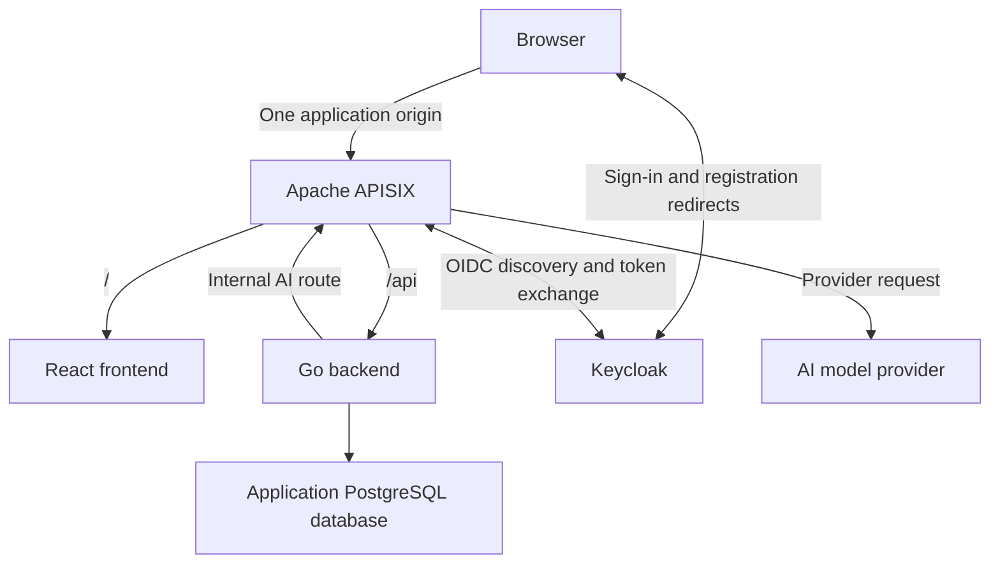

# Cartside

A conversational grocery storefront built with Go, React, PostgreSQL, and Apache APISIX.

Cartside lets customers browse groceries, search for products, and build a cart manually or with help from an AI shopping assistant. The assistant suggests products from the catalog, and customers accept or decline each suggestion before anything is added to their cart.

This is a personal learning project focused on Go application design, API gateway policies, OIDC integration, and AI provider integration.

## Project status

Implemented: the Go/Chi server, unauthenticated liveness and PostgreSQL readiness, a shared pgx v5 pool, graceful shutdown, and local PostgreSQL in Docker Compose. The storefront, business modules, remaining infrastructure, authentication, frontend, CI, and AI integration are planned. Unless stated otherwise, the architecture and scope below describe the intended design.

## MVP

- Open registration and sign-in, required to access the storefront and chat.
- A fixed sample grocery catalog with product images, prices, and search.
- A separate cart for each customer, with manual quantity changes and item removal.
- Immediate cart updates within the current browser.
- An embedded AI chat that recommends catalog products based on customer requests.
- Individual acceptance or rejection of each suggested item.
- Simulated checkout that saves an order, returns a confirmation number, and clears the cart.

Real payments, delivery integrations, live inventory, and synchronization across tabs or devices are outside the initial scope.

## Architecture



The incoming application routes and internal AI route have separate policies, initially within one APISIX instance. Keycloak uses its own database or isolated database configuration; application modules do not access its credential storage.

### Responsibilities

| Component | Responsibility |
| --- | --- |
| React | Storefront, search, cart, chat, suggestion acceptance, and checkout UI |
| APISIX | Application routing, OIDC login flow and session enforcement, AI routing, and request limits |
| Keycloak | Registration, credentials, and user authentication |
| Go | Application authorization, business rules, catalog access, carts, orders, and AI conversation coordination |
| PostgreSQL | Persistent application data |
| AI provider | Generate shopping suggestions using catalog context supplied by Go |

### Authentication and access

APISIX manages the OIDC flow with Keycloak and maintains the browser session. React does not manage OIDC tokens. Go uses trusted identity information from the gateway to enforce access to each customer's data.

The design must prevent forged identity headers and direct access that bypasses gateway authentication. Session configuration and state-changing requests must account for cookie security and CSRF protection. Registration, authentication callbacks, and operational health routes require deliberate routing exceptions.

The AI provider key belongs to APISIX. The internal AI route must require service authentication or internal access restrictions; a storefront session alone does not grant access to it. Per-user AI limits must use a verified identity propagated through the backend.

## Go backend

The backend will be a modular monolith: one Go application with five internal business modules. Currently, `cmd/api` manages process startup and shutdown, `internal/database` validates database configuration and creates the pool, and `internal/httpapi` serves health routes. Pool creation does not wait for PostgreSQL. The process closes the shared pool after HTTP shutdown.

| Module | Responsibility |
| --- | --- |
| Accounts | Application user records and association with the identity provider |
| Catalog | Product data, search, and authoritative product prices |
| Cart | Cart ownership, items, quantities, and cart versions |
| Orders | Checkout coordination, order records, and confirmations |
| Shopping assistant | Conversation coordination, catalog context, and product suggestions |

Modules interact through defined operations rather than directly modifying another module's tables. Manual additions and accepted AI suggestions use the same cart operations. The model does not control authoritative product IDs, prices, or ownership decisions.

### Checkout consistency

The orders module coordinates checkout with cart and catalog operations.

- Save the order and clear the cart in one database transaction.
- Preserve the cart if the transaction fails.
- Associate each checkout attempt with an idempotency key scoped to the user.
- Return the existing confirmation when a completed attempt is retried.
- Associate checkout with the cart version the customer reviewed; reject stale attempts.
- Serialize checkout and cart mutations through a consistent cart-locking strategy.

Retrying the same checkout uses the same key. A changed cart requires a new checkout attempt. Database constraints and transaction boundaries enforce these rules alongside application validation.

## Repository organization

One repository contains the frontend, backend, infrastructure configuration, and documentation. The following top-level layout is proposed:

| Path | Contents |
| --- | --- |
| `frontend/` | React and TypeScript application |
| `backend/` | Go application and internal modules |
| `infra/` | APISIX and Keycloak configuration and supporting infrastructure |
| `docs/` | Architecture notes and implementation decisions |
| `.github/workflows/` | CI, manual build, and eventual deployment workflows |
| `compose.yaml` | Local infrastructure services |
| `.env.example` | Required local configuration with safe placeholders |

## Local development

React and Go are intended to run directly on the developer's machine. Docker Compose currently runs PostgreSQL; APISIX, Keycloak, React, and supporting gateway services are planned.

The browser accesses the application through one APISIX address. APISIX routes `/` to the React development server and `/api` to Go. The setup must account for container-to-host connectivity, React development WebSocket traffic, and a consistent Keycloak issuer URL reachable by both the browser and gateway.

### Configuration

- Keep local configuration in an untracked `.env` file.
- Commit `.env.example` with required names, descriptions, and placeholders.
- Validate required configuration at service startup.
- Keep credentials, API keys, and session secrets out of Git and browser bundles.
- Choose deployment secret storage when the hosting environment is selected.

### Setup instructions

The backend runs on the host with Go 1.24 or later; Docker Compose runs PostgreSQL 17.10. From the repository root:

```sh
cp .env.example .env
# Edit .env: choose a local password and match its URL-encoded value in DATABASE_URL.
docker compose config --quiet
docker compose up -d --wait postgres
# Explicitly export the trusted local file into this shell before running Go:
set -a
. ./.env
set +a
cd backend
go run ./cmd/api
```

Compose automatically reads the root `.env` for interpolation of PostgreSQL settings; it does not export variables into your shell. Go reads only its process environment and does not load `.env`. The shell commands above export `DATABASE_URL` and the optional `HTTP_ADDR`. Only source a trusted file, using shell-compatible assignments. Alternatively, supply `DATABASE_URL` directly in the Go process environment.

`DATABASE_URL` is required and must be a PostgreSQL URL with a host, user, and database name. Missing or malformed configuration fails startup with a generic error. A database connection failure does not prevent startup. `HTTP_ADDR` defaults to `:8080`; the example binds to loopback. Local `sslmode=disable` is for this host-only development setup.

In another terminal, from the repository root:

```sh
curl -i http://127.0.0.1:8080/health/live
curl -i http://127.0.0.1:8080/health/ready
docker compose stop postgres
curl -i http://127.0.0.1:8080/health/live
curl -i http://127.0.0.1:8080/health/ready
docker compose up -d --wait postgres
curl -i http://127.0.0.1:8080/health/ready
```

With PostgreSQL available, both endpoints return HTTP 200 and `{"status":"ok"}`. While PostgreSQL is stopped, liveness stays 200 and readiness returns HTTP 503 with `{"status":"unavailable"}`. Each readiness request pings through the shared pool with a one-second context timeout; subsequent requests recover automatically after PostgreSQL returns. To verify initially unavailable startup, stop PostgreSQL before starting Go, then start PostgreSQL while Go stays running.

Both routes are unauthenticated and return JSON. Liveness performs no dependency checks. Stop Go with Ctrl+C (SIGINT); SIGTERM also initiates graceful shutdown with up to 10 seconds for active HTTP requests, followed by pool closure.

PostgreSQL data persists in the Compose named volume across stops and container recreation. Use `docker compose stop postgres` to stop it without deleting data. Do not use `docker compose down -v` unless intentionally deleting data. PostgreSQL initialization variables apply only to an empty volume; changing credentials in `.env` does not change an existing database user's password.

Backend validation commands (run from `backend/`):

```sh
gofmt -w cmd internal
go vet ./...
go test ./...
go build ./...
```

The full application quick start will be documented when its infrastructure and sign-in flow are implemented.

## Health checks

- **Go liveness (implemented):** `GET /health/live` confirms the process can respond.
- **Go readiness (implemented):** `GET /health/ready` checks PostgreSQL reachability with a bounded ping.
- **Infrastructure health:** Separate checks for APISIX, Keycloak, and PostgreSQL.
- **Routing check:** A request through APISIX reaches Go.
- **Authentication check:** A signed-in request reaches a protected Go endpoint, while an unauthenticated API request is rejected.

Routine health probes do not call a paid AI provider. Healthy individual services do not replace checks of routing and authentication across components.

## CI and delivery

GitHub Actions will run on pull requests and pushes to `main`:

- Go formatting checks, static analysis, and tests.
- Frontend linting, TypeScript checks, and a production build.
- Go build verification.

A manually triggered build workflow will produce deployable artifacts. A separate manual deployment workflow will be added once a hosting target is selected. Deployment is outside Phase 1.

## Phase 1: foundation

Implementation order:

1. Create the repository scaffold and configuration template.
2. Establish local infrastructure with Docker Compose.
3. Add Go liveness and PostgreSQL readiness checks.
4. Route the frontend and backend through APISIX.
5. Configure Keycloak registration and APISIX-managed sign-in.
6. Add a protected current-user endpoint and verify authentication boundaries.
7. Add CI and verify the documented setup from a fresh clone.

Exit criteria:

- [x] Go runs locally with a configurable listen address and graceful shutdown.
- [x] Go liveness responds directly with HTTP 200 and the expected JSON, without authentication or external dependency checks.
- [x] Backend formatting, vet, test, and build checks pass.
- [x] The README contains verified backend run and liveness verification commands.
- [x] Local PostgreSQL and Go configuration is documented in the committed template.
- [x] Local PostgreSQL infrastructure is configured with Docker Compose (remaining services are planned).
- [ ] React and Go run locally behind APISIX.
- [ ] Go liveness and readiness checks work through the gateway.
- [ ] A customer can register and sign in through Keycloak.
- [ ] An authenticated request reaches a protected Go endpoint and resolves the user's identity.
- [ ] An unauthenticated API request is rejected.
- [ ] Initial CI checks pass.
- [ ] The README contains verified setup and verification instructions for the full application.

## Later milestones

- Implement the product catalog and search.
- Implement customer carts and ownership checks.
- Add AI suggestions and explicit customer acceptance.
- Implement simulated checkout and retry protections.
- Prepare deployment and managed secret delivery.

Building a custom Go OIDC provider is a potential separate learning milestone after the application works with Keycloak.
